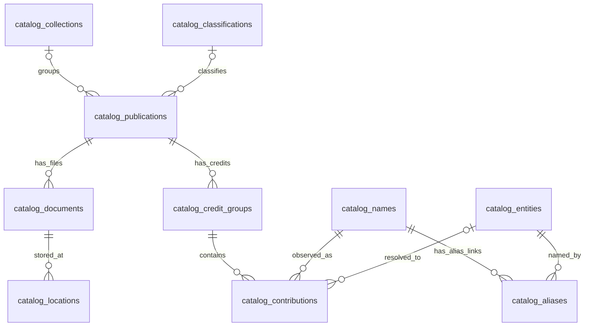

# Library database reference for the administration service

This is the entry point for an agent building the library administration service in a separate repository. Manzara owns the existing catalog and its operations; this repository currently exposes a terminal CLI and workflow runners, with no retained HTTP API. The new service will need a backend database integration.

This reference describes the checked-in schema and code at baseline `20261008_0062`. The owner reports the catalog migration complete, but this documentation task did not connect to the database or inspect live records. Verify the deployed revision and relations before implementing against them. The [catalog contract](catalog-model.md) owns domain and mutation rules; [operations](operations.md#database-tools) owns bootstrap and recovery.

## How to connect

Connection details are in the owner's **private YAML configuration**, not in this document. Obtain that file or the required settings through a private channel. Do not copy credentials, database URLs, certificates, or document access tokens into either repository.

| Setting | Meaning |
| --- | --- |
| `database_url` | PostgreSQL URL containing host, port, database, role/password, and TLS options. Retain its TLS parameters and any `sslrootcert` certificate path. |
| `database_schema` | Schema containing the `catalog_*` tables and durable workflow tables. The masked example uses `monocorpus`; read the actual configured value. |
| `migration_version_schema` | Schema containing the migration version table, `alembic_version_manzara`; it can differ from the catalog schema. |
| `database_pool_size` | Explicit per-process pool bound, an integer from 1 through 8. Separate service workers each consume their own pool budget. |
| `postgres.connect_timeout_seconds`, `postgres.pool_recycle_seconds` | Required by the shared engine constructor. Other operation timeout fields are listed in the example configuration. |
| `database_ca_certificate_base64` | Optional CA provisioning input. Setup can materialize it into a private certificate file; the engine itself uses the TLS options in `database_url`. |
| `local_state_path` | SQLite runtime database path. Required by Manzara settings, but this is not the library catalog connection. |

Manzara uses Python 3.12+, SQLAlchemy, and psycopg2; exact dependencies live in [requirements.txt](../requirements.txt). PostgreSQL bootstrap requires **PostgreSQL 18+, UTF-8**, and `pg_trgm` in `public`, because catalog SQL uses PostgreSQL-specific functions, triggers, JSONB, Unicode case folding, and search indexes.

[app/runtime_config.py](../app/runtime_config.py) reads repository-root `config.yaml`, or the explicit path selected by `MANZARA_CONFIG_PATH`. The environment selects the file only; it does not override YAML values. [config.example.yaml](../config.example.yaml) is masked documentation and cannot be loaded at runtime. Missing settings fail. For a separate service, explicitly configure its own private settings source rather than assuming Manzara's loader will find configuration in the new repository.

Within Manzara, all repositories share [app/postgres_engine.py](../app/postgres_engine.py)'s bounded engine for a database/schema pair. It uses `max_overflow=0`, connection health checks, and `search_path=<database_schema>,public`. Use the same engine registry when integrating code into this process. A standalone service owns its own connections and must set the configured schema explicitly; defaulting to `public` will miss the normalized catalog tables.

Example **read-only** access from the Manzara checkout, using the owner's selected private YAML:

```python
from sqlalchemy import select, text

from app.catalog.schema import build_metadata
from app.postgres_engine import acquire_postgres_engine, release_postgres_engine
from app.settings import load_settings

settings = load_settings()
engine = acquire_postgres_engine(
    settings.database_url,
    schema=settings.database_schema,
    pool_size=settings.database_pool_size,
)
try:
    tables = build_metadata(settings.database_schema).tables
    publications = tables[f"{settings.database_schema}.catalog_publications"]
    with engine.begin() as conn:
        conn.execute(text("SET TRANSACTION READ ONLY"))
        rows = conn.execute(
            select(
                publications.c.publication_id,
                publications.c.name,
                publications.c.inclusion,
                publications.c.revision,
            ).order_by(publications.c.publication_id).limit(20)
        ).mappings().all()
finally:
    release_postgres_engine(engine)
```

This example is for browsing, not for editing metadata. Constructing SQLAlchemy table objects does not initialize the deployed schema. Do not call `create_all()` or run migrations during service startup; migrations are separate owner-managed operations.

## Main relationships

A **publication** is an edition, translation, or issue with shared bibliography. A **document** is a particular file, identified by its MD5. An **entity** is a person, organization, or unresolved identity. These are different identifiers and should remain distinct in routes and forms.



Every document belongs to exactly one publication. A publication can have multiple documents or no documents after cleanup. New source MD5s initially receive separate pending publications; matching titles or ISBNs do not automatically establish that files belong to the same edition. Collection membership is publication-level, so changing it affects every file of that publication.

## Primary tables and fields

All tables in this section live in `database_schema`. Integer IDs are PostgreSQL `bigint`; document `md5` is text and application validation requires 32 lowercase hexadecimal characters. Versioned records carry `revision` and `updated_at`; revision-aware commands check the reviewed state before applying changes.

| Table / primary key | Contents and important fields |
| --- | --- |
| `catalog_publications` / `publication_id` | Bibliography: `name`, `work_type`, `description`, `edition`, `date_published`, `page_count`. Decisions: `inclusion`, `evaluation_method`. Nullable links: `classification_id`, `collection_id`, `merged_into_id`. Also `audience_array`, `has_metadata`, `metadata_present`, collection item title/timestamps, revision/timestamp. |
| `catalog_documents` / `md5` | Required `publication_id`; `mime_type`, `complete`, `restricted`, `selected`, `content_extraction_method`, `meta_extraction_method`, revision/timestamp. Bibliographic title, ISBN, language, and credits belong to its publication. |
| `catalog_locations` / `location_id` | File location and integrity checkpoint: `md5`, `provider`, `purpose`, `locator`, `source_path`, `resource_id`, `public_url`, `public_key`, `size`, `etag`, `verified_at`, revision/timestamp. Unique `(md5, provider, purpose)`; size is bytes and can be unknown. File bytes are outside PostgreSQL. |
| `catalog_collections` / `collection_id` | `title`, `notes`, independent `include_in_library` boolean, derived `normalized_title`, `metadata_template_json` (JSON encoded as text), source/application timestamps, revision/timestamp. |
| `catalog_classification_nodes` / `node_id` | Taxonomy tree: `parent_id`, `ddc`, `label_en`, `label_tt`, revision/timestamp. Triggers prevent cycles and enforce DDC consistency. |
| `catalog_classifications` / `classification_id` | Stable classification identity attached to a unique `node_id`; `status`, `created_by`, `created_at`, revision/timestamp. Publications reference this ID rather than a label/path. |
| `catalog_entities` / `entity_id` | Identity: `kind`, `display_name`, `approval`, `status`, nullable `merged_into_id`, derived `normalized_name`, `identity_key`, `notes`. Structured person fields: `surname_full`, `surname_initials`, `name_full`, `name_initials`, `father_name_full`, `father_name_initials`, `title`, `sex`. Also source timestamps, revision/timestamp. |
| `catalog_entity_roles` / `(entity_id, role)` | Identity roles. There are no independent author/publisher identity tables; people and organizations share `catalog_entities`. |
| `catalog_names` / `name_id` | Observed spelling: `kind`, `raw_name`; unique `(kind, raw_name)`. A spelling is not proof of identity. |
| `catalog_aliases` / `alias_id` | Link from `name_id` to `entity_id`, with `approval`, revision/timestamp. Unique `(name_id, entity_id)` allows a spelling to be linked to multiple identities. |
| `catalog_alias_reviews` / `alias_id` | Name review/normalization record: `name_id`, `entity_type`, nullable `entity_id`, `decision_status`, script/name decomposition, counts, confidence, reason, model/contract fields. Unique `(entity_type, name_id)`. Its IDs are separate from `catalog_aliases.alias_id`; do not join them by matching ID values. |
| `catalog_credit_groups` / `(publication_id, role, position)` | Outer credit group and optional custom `role_name`. Positions preserve the bibliographic grouping. |
| `catalog_contributions` / `contribution_id` | A particular credit occurrence: `publication_id`, `role`, `position`, `nested_position`, required `name_id`, nullable resolved `entity_id`, `resolution`, revision/timestamp. Unique `(publication_id, role, position, nested_position)`; references its parent credit group. |

`inclusion` is `pending`, `included`, or `excluded`. Entity `kind` is `person`, `organization`, or `unknown`; entity `status` is `active`, `merged`, or `archived`. Entity/alias `approval` and contribution `resolution` are independently `unconfirmed` or `confirmed`. A confirmed contribution requires an entity ID; a merged entity requires a merge target. Active status and successful AI processing do not mean human confirmation.

Credit roles supported by the metadata envelope are `author`, `editor`, `translator`, `illustrator`, `publisher`, and `contributor`. A custom role label belongs to the credit group. Resolving one contribution does not resolve every occurrence of its spelling, and adding an alias does not automatically resolve matching credits.

`date_published` is text to preserve year/month/day precision (`YYYY`, `YYYY-MM`, or `YYYY-MM-DD`), rather than forcing an exact date. `page_count` must be positive when supplied. Some source/historical timestamp fields are text; inspect actual column types before imposing a single timestamp serializer.

`has_metadata` determines whether the legacy metadata record exists. `metadata_present` determines whether its Schema.org payload is present. The legacy `public.metadata` view has no row when `has_metadata=false`, and can have a row with a null payload when `metadata_present=false`. Use the publication/document tables for complete inventory.

### Ordered metadata relations

Editable lists are stored in child rows, not inside a master JSON document. Preserve `position`, repeated values, nested groups, and absent-versus-empty distinctions when reading and writing.

| Table / primary key | Values |
| --- | --- |
| `catalog_publication_languages` / `(publication_id, position)` | `language`; ordered language strings. |
| `catalog_identifiers` / `(publication_id, kind, position)` | `value`, derived `normalized`; ISBN is one identifier kind. Equal normalized ISBNs are not a uniqueness/merge rule. |
| `catalog_genres` / `(publication_id, position)` | Genre `value`. |
| `catalog_subjects` / `(publication_id, position)` | Defined term: `name`, `term_code`, `set_name`, `set_url`, `set_is_url`. |
| `catalog_audiences` / `(publication_id, position)` | `kind`, `audience_type`, `min_age`, `max_age`; ages are nonnegative and minimum cannot exceed maximum. Publication `audience_array` preserves envelope shape. |
| `catalog_references` / `publication_id` | At most one supporting/source-work record: `work_type`, `name`, `language`, `urls_present`. This is not a foreign key claiming another publication is the same work. |
| `catalog_reference_urls` / `(publication_id, position)` | Reference `url`; requires `urls_present=true`. Empty URLs with presence true and absent URLs with presence false are distinct. |
| `catalog_reference_authors` / `(publication_id, position)` | Reference-author `kind`, `name`; owned by the reference, not the main publication's credit list. |
| `catalog_document_access_modes` / `(md5, position)` | `mode`: `auditory`, `tactile`, `textual`, or `visual`. |
| `catalog_sufficient_modes` / `(md5, position)` | Outer accessibility group; a group can have no child items. |
| `catalog_sufficient_mode_items` / `(md5, group_position, position)` | Ordered mode within a sufficient-mode group, using the same mode vocabulary. |

### Locations and privacy

Current location combinations include:

| Provider / purpose | Meaning |
| --- | --- |
| `yandex` / `source` | Upstream Yandex Disk path/resource identity and optional public sharing metadata. |
| `s3` / `primary` | Primary source file locator and verified size/ETag/time. |
| `s3` / `content` | Generated content locator. |

A locator is not necessarily an anonymously fetchable URL. Restricted documents can use encrypted `enc:` locators. Interpret them through [app/document_storage.py](../app/document_storage.py) and the [document contract](../app/modules/library/guidance/documents.md); storage credentials and encryption settings are separate from the database connection.

Inclusion does not override `restricted`, `complete`, `selected`, or collection decisions. Raw location rows can contain sensitive links even when a document is restricted. The legacy `public.document` projection suppresses restricted Yandex public links, but direct table reads need backend access control. Unknown source privacy fails closed. Restricted documents and previews require private storage and authenticated delivery; never return raw locators or tokens to a public client.

## Reviews, provenance, and previews

| Table / primary key | Responsibility |
| --- | --- |
| `catalog_evidence` / `evidence_id` | Source/review payload `payload` (JSONB), `source`, `record_kind`, text `record_key`, optional `md5`, creation timestamp. |
| `catalog_revisions` / `revision_id` | Transactional audit: `record_kind`, text `record_key`, `actor`, JSONB `before`/`after`, creation timestamp. This is distinct from a row's numeric `revision`. |
| `catalog_protections` / `(record_kind, record_key, field)` | Human-protected fields and responsible `actor`. |
| `catalog_proposals` / `proposal_id` | Pending changes: `kind`, `status`, `display_name`, JSONB `evidence`/`field_changes`, optional `publication_id`, revision/timestamp. Metadata, identity/publisher, and current collection discovery use catalog proposals. Inspect the kind/source contract before interpreting payloads. |
| `catalog_proposal_members` / `member_id` | Proposal member snapshot and `reviewed_revision`; exactly one of `entity_id` or `name_id` is present. Partial unique indexes prevent duplicate members of either type within a proposal. |
| `catalog_separations` / `(left_key, right_key)` | Explicit identity pairs that must remain separate, with `actor`; ordered keys satisfy `left_key < right_key`. |
| `catalog_imports` / `import_id` | Import provenance: unique `source_fingerprint`, JSONB `manifest`, `state`, creation timestamp. |
| `catalog_preview_requests` / `request_id` | Durable generation intent: `md5`, `idempotency_key`, `recipe`, `status`, `private`, `actor`, `claim_token`, `lease_until`, `source_page_count`, creation timestamp. Unique `(md5, idempotency_key)`. |
| `catalog_preview_pages` / `(request_id, role)` | Selected page number and `small_key`/`large_key` assets for roles `first`, `second`, `last`. Page numbers are one-based. |

Preview handlers use `pending`, `processing`, `ready`, and `failed`. Claims have tokens and leases; expired work is recoverable. Read `catalog_selected_previews` to choose the latest successful privacy-compatible generation, then join its `request_id` to pages for asset keys. A newer failed regeneration does not erase prior success. This projection does not itself establish public eligibility; apply the document/publication rules as well.

## Other durable tables

These PostgreSQL records are checkpoints, review evidence, or preserved history. They are not replacements for the catalog model above.

| Table | Responsibility / key |
| --- | --- |
| `document_cleanup_queue` | `cleanup_id`; planned move/delete, scope, MD5/resource/path, status, resumable phase, JSONB evidence, lifecycle timestamps. Use the guarded cleanup executor, not direct row deletion, for remote cleanup. |
| `library_isbn_duplicate_reviews` | `review_id`; ISBN cohort/hash, candidates/evidence/keep decisions, status/timestamps. |
| `public.isbn_keep_many` | `(isbn_key, md5)`; explicit keep-many exceptions for ISBN cleanup. This table lives in `public`. |
| `library_non_pdf_extraction_state` | `md5`; durable `ready`/`unsupported`/`detected` decision, recipe version, verified source MIME, output timestamp/reason. |
| `library_upstream_metadata` | `md5`; original external metadata object in JSONB `payload_json`. It has no document FK and can exist before discovery; it is evidence rather than edited catalog truth. |
| `personality_normalization_checkpoints` | `raw_name`; source fingerprint, contract versions, decision/evidence, nullable `canonical_id` referencing an entity, successful model/timestamps. |
| `publisher_merge_analyses` | `analysis_id`; inventory/fingerprint, scope, metadata, response, durable analysis state. |
| `publisher_review_draft`, `publisher_separations` | Preserved publisher review draft and explicit separation evidence. |
| `normalization_events`, `normalization_suggestions` | Preserved normalization history/review contracts. Identity facts live in catalog entities/names/aliases/contributions. |
| `library_collection_events`, `library_collection_signatures`, `library_collection_proposals`, `library_collection_proposal_items` | Preserved collection history and former proposal/validation contracts. Current discovery writes `catalog_proposals`; these historical proposal tables are not its active inbox. |

Local SQLite, at `local_state_path`, contains `runs`, Gemini coordination tables, `ai_item_checkpoints`, and `operational_items`. It owns run options/progress/errors, retry/model exclusions, CLI state, and reproducible caches. PostgreSQL owns domain facts and safety-critical checkpoints. There is no fallback or dual-write between the stores; an administration service must not use a machine's SQLite file as shared library truth. See [store ownership](catalog-model.md#store-ownership) for the workflow split.

## Read projections and legacy names

| View / function | Use |
| --- | --- |
| `catalog_publication_metadata` | Publication scalars plus languages reconstructed in order. |
| `catalog_document_metadata` | Document scalars plus reconstructed access modes. |
| `catalog_sufficient_mode_metadata` | Reconstructed sufficient-mode groups. |
| `catalog_reference_metadata` | Reference scalars plus ordered URLs. |
| `catalog_contribution_metadata` | Contributions with group-owned role labels. |
| `catalog_selected_previews` | Latest successful generation compatible with document privacy. |
| `catalog_publisher_proposals` | Publisher-specific projection of catalog proposals. |
| `catalog_schema_org(md5)` | PostgreSQL function producing the bibliographic Schema.org JSONB envelope from normalized facts. |
| `public.document`, `public.metadata`, `public.classification` | Legacy adapter views; no independent domain rows. |
| `normalization_canonicals`, `normalization_aliases`, `library_collections`, `library_collection_items` | Legacy adapter views in the catalog schema. |

Schema.org JSON is generated transport, not the authoritative document to overwrite. [app/catalog/metadata.py](../app/catalog/metadata.py) maps supported envelope fields to normalized relations; [app/catalog/schema_org.py](../app/catalog/schema_org.py) validates the envelope. JSONB remains appropriate for evidence, proposals, snapshots, manifests, and audit data.

Adapter views have trigger-backed command contracts and no unique indexes for ordinary `ON CONFLICT` upserts. New admin code should use normalized relations and reviewed backend commands rather than relying on legacy writes. Python table metadata does not describe every deployed function, trigger, view, or historical table; consult the frozen SQL as well.

## Query examples

These SQL snippets assume a connection with the configured `search_path` and a read-only transaction. `:publication_id`, `:md5`, and `:schema` are SQLAlchemy bind parameters; provide values separately, never interpolate user input into SQL. They are backend browsing queries, not public-access eligibility filters.

Publication with its files and independently controlled collection:

```sql
SELECT p.publication_id, p.name, p.date_published, p.inclusion,
       p.revision AS publication_revision,
       c.collection_id, c.title AS collection_title, c.include_in_library,
       d.md5, d.mime_type, d.complete, d.restricted, d.selected,
       d.revision AS document_revision
FROM catalog_publications p
LEFT JOIN catalog_collections c ON c.collection_id = p.collection_id
LEFT JOIN catalog_documents d ON d.publication_id = p.publication_id
WHERE p.publication_id = :publication_id
ORDER BY d.md5;
```

Credits with observed spelling and optional resolved identity:

```sql
SELECT cr.contribution_id, cr.role, cr.position, cr.nested_position,
       g.role_name, n.name_id, n.raw_name, n.kind AS observed_kind,
       e.entity_id, e.display_name, e.approval, e.status,
       cr.resolution, cr.revision
FROM catalog_contributions cr
JOIN catalog_credit_groups g
  ON (g.publication_id, g.role, g.position)
   = (cr.publication_id, cr.role, cr.position)
JOIN catalog_names n ON n.name_id = cr.name_id
LEFT JOIN catalog_entities e ON e.entity_id = cr.entity_id
WHERE cr.publication_id = :publication_id
ORDER BY cr.role, cr.position, cr.nested_position;
```

Generated bibliographic envelope, preserving missing-payload semantics:

```sql
SELECT d.md5, p.publication_id, p.has_metadata, p.metadata_present,
       CASE WHEN p.metadata_present THEN catalog_schema_org(d.md5) END AS schema_org
FROM catalog_documents d
JOIN catalog_publications p USING (publication_id)
WHERE d.md5 = :md5;
```

Inspect deployed relations and columns without modifying data:

```sql
SELECT table_schema, table_name, table_type
FROM information_schema.tables
WHERE table_schema IN (:schema, 'public')
ORDER BY table_schema, table_name;

SELECT table_name, column_name, data_type, is_nullable, column_default
FROM information_schema.columns
WHERE table_schema = :schema
ORDER BY table_name, ordinal_position;
```

For the deployed migration revision, read `"<migration_version_schema>".alembic_version_manzara.version_num`, replacing the schema with the validated configured identifier. Schema/table identifiers cannot be value-bound. [alembic/env.py](../alembic/env.py) defines the version table. The current collection-discovery preflight still queries `alembic_version` instead; treat that as a code discrepancy to investigate, not as a reason to create another version table or restamp the database.

## Implementing administration writes

Use [app/catalog/repository.py](../app/catalog/repository.py) and the focused [app/catalog/](../app/catalog/) stores as the implementation reference. `CatalogRepository` composes metadata, personality, and preview stores over the shared engine; [app/db.py](../app/db.py) is the operations facade and also handles local SQLite, so it is not a ready-made webservice data layer. Some metadata primitives are private methods intended for existing flow composition; this repository has no general admin or metadata-proposal review API/CLI to call.

An admin write handler must validate its controls, check reviewed revisions, acquire the appropriate row/document locks, preserve protected fields and confirmed contributions, update normalized children in order, advance the owning record revision, and write audit/evidence in the same transaction. [app/catalog/contracts.py](../app/catalog/contracts.py) defines validation and `CatalogConflict`/`CatalogNotFound`; on a stale revision, reload and request a fresh review. Direct SQL updates bypass application protections/audits even when database constraints still pass. Automatic changes to protected facts become proposals rather than silently replacing reviewed values.

Deletion needs explicit domain handling: publication references from documents use `ON DELETE RESTRICT`; document-owned locations/accessibility/previews cascade; publication-owned metadata children cascade; referenced identities are generally restricted. Cleanup and storage operations also coordinate through [app/document_operation_lock.py](../app/document_operation_lock.py). Do not infer that deleting a database row deletes remote file objects.

Search keys are derived by database triggers (`catalog_name_key`, `catalog_title_key`, `catalog_identifier_key`). They support lookup, not uniqueness or automatic identity merging. Prefer backend-owned domain decisions and send clients explicit display DTOs and revision tokens. Any new persisted-data migration or compatibility policy requires owner agreement.

## Source map and verification limits

- [Catalog contract](catalog-model.md): authoritative behavior, store ownership, review/privacy rules.
- [Python schema](../app/catalog/schema.py): table names, columns, relationships used by catalog repositories.
- [Frozen baseline SQL](../alembic/sql/baseline_0062.sql): complete durable schema, projections, generated keys, constraints, indexes, and triggers.
- [Settings](../app/settings.py), [configuration loader](../app/runtime_config.py), [engine registry](../app/postgres_engine.py): connection/configuration behavior.
- [Metadata store](../app/catalog/metadata_store.py), [preview store](../app/catalog/previews.py), [document sync](../app/catalog/document_sync.py): transactional write examples.
- [Operations](operations.md#database-tools), [backup/recovery](postgres-backup-recovery.md): deployment/bootstrap/recovery ownership.

This reference was verified through source inspection and documentation checks only. No tests, credential-backed queries, service execution, or migrations were performed. Follow the repository's [verification policy](verification.md) before running those checks.
